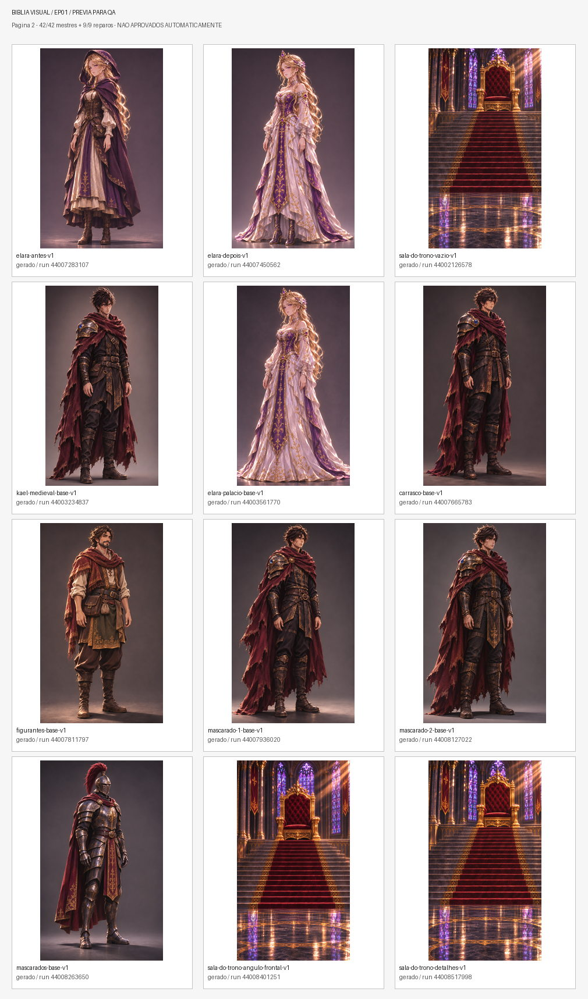
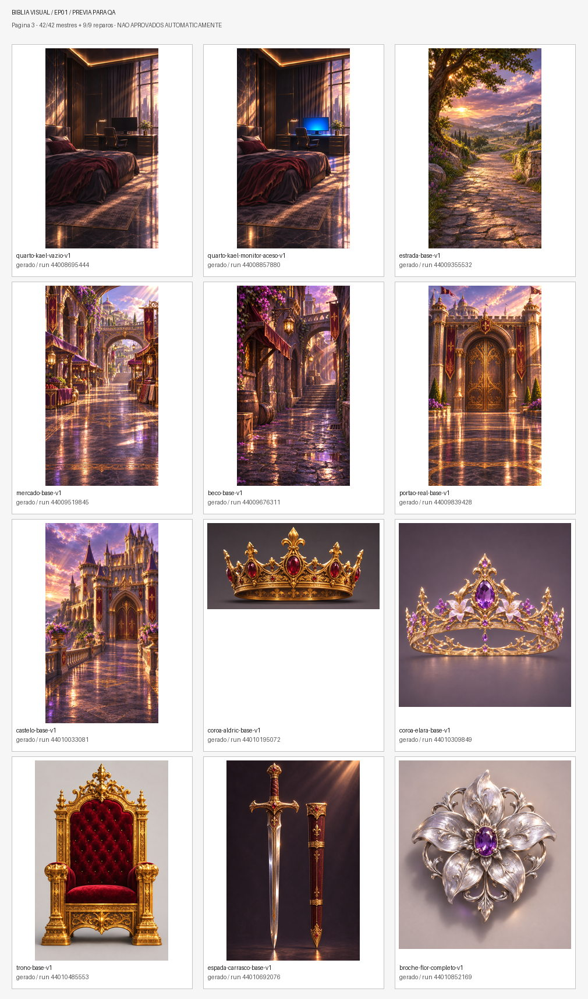
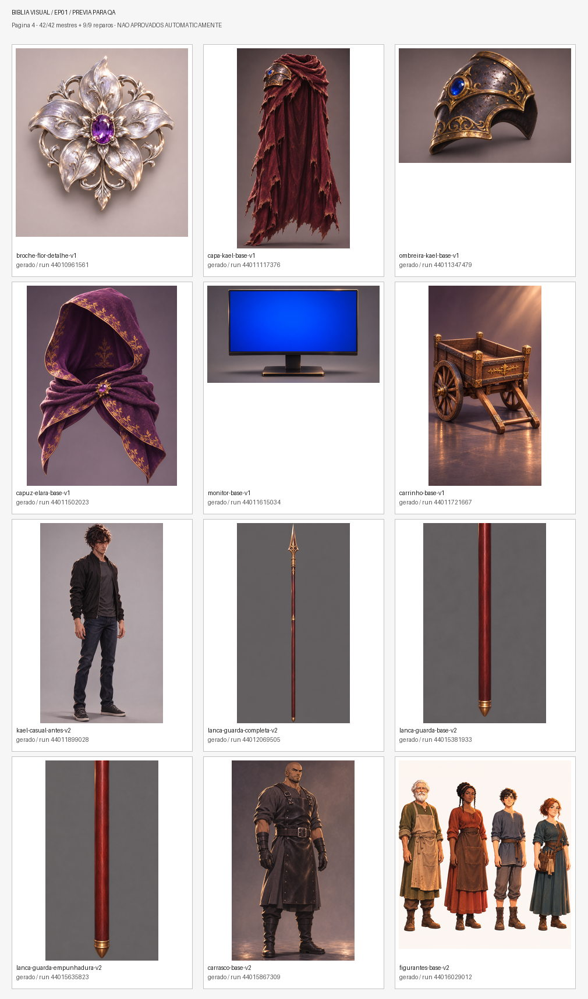
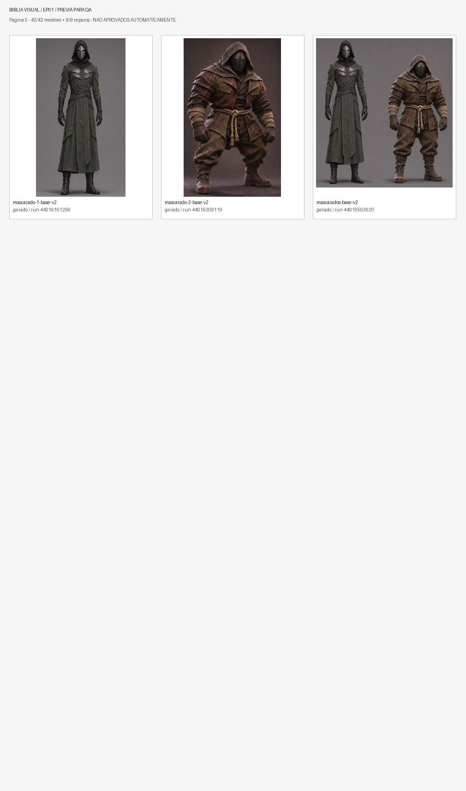

# Galeria visual de revisão — EP01

**42 de 42 referências-mestre** arquivadas e verificadas por SHA256.
**9 de 9 reparos V2** gerados; são candidatos separados e não substituem os PNGs V1.
**Nenhuma miniatura substitui o original. Gerado não significa aprovado.**
Esta galeria é atualizada pelo GitHub Actions após cada lote, sem nova geração de IA.

## Arquivos originais e proveniência

| Referência | Estado visual | SHA-256 | Workflow |
|---|---|---|---|
| [biblia-aldric-tribunal-v1](../videos/mmorpg-conquiste-a-princesa-ep01/assets/geracoes/production-art-request/44005400386/biblia-aldric-tribunal-v1.png) | gerado (não aprovado automaticamente) | `37c48afcaa240f03…` | [#44005400386](https://github.com/HelioConde/VideoForge-IA/actions/runs/44005400386) |
| [biblia-aldric-revelacao-v1](../videos/mmorpg-conquiste-a-princesa-ep01/assets/geracoes/production-art-request/44005550858/biblia-aldric-revelacao-v1.png) | gerado (não aprovado automaticamente) | `f9e4180cf463d385…` | [#44005550858](https://github.com/HelioConde/VideoForge-IA/actions/runs/44005550858) |
| [biblia-guarda-esquerdo-cerimonial-v1](../videos/mmorpg-conquiste-a-princesa-ep01/assets/geracoes/production-art-request/44005682487/biblia-guarda-esquerdo-cerimonial-v1.png) | gerado (não aprovado automaticamente) | `cfa01b0f4781a67f…` | [#44005682487](https://github.com/HelioConde/VideoForge-IA/actions/runs/44005682487) |
| [biblia-guarda-direito-cerimonial-v1](../videos/mmorpg-conquiste-a-princesa-ep01/assets/geracoes/production-art-request/44005833952/biblia-guarda-direito-cerimonial-v1.png) | gerado (não aprovado automaticamente) | `3fcdaa067b55d3d7…` | [#44005833952](https://github.com/HelioConde/VideoForge-IA/actions/runs/44005833952) |
| [biblia-lanca-guarda-completa-v1](../videos/mmorpg-conquiste-a-princesa-ep01/assets/geracoes/production-art-request/44006036546/biblia-lanca-guarda-completa-v1.png) | gerado (não aprovado automaticamente) | `710b49e6a3943535…` | [#44006036546](https://github.com/HelioConde/VideoForge-IA/actions/runs/44006036546) |
| [biblia-lanca-guarda-base-v1](../videos/mmorpg-conquiste-a-princesa-ep01/assets/geracoes/production-art-request/44006194009/biblia-lanca-guarda-base-v1.png) | gerado (não aprovado automaticamente) | `59173823904d297a…` | [#44006194009](https://github.com/HelioConde/VideoForge-IA/actions/runs/44006194009) |
| [biblia-lanca-guarda-empunhadura-v1](../videos/mmorpg-conquiste-a-princesa-ep01/assets/geracoes/production-art-request/44006327786/biblia-lanca-guarda-empunhadura-v1.png) | gerado (não aprovado automaticamente) | `a34a131bdd0de07a…` | [#44006327786](https://github.com/HelioConde/VideoForge-IA/actions/runs/44006327786) |
| [biblia-kael-casual-antes-v1](../videos/mmorpg-conquiste-a-princesa-ep01/assets/geracoes/production-art-request/44006463096/biblia-kael-casual-antes-v1.png) | gerado (não aprovado automaticamente) | `84ff479d3699d050…` | [#44006463096](https://github.com/HelioConde/VideoForge-IA/actions/runs/44006463096) |
| [biblia-kael-ferido-v1](../videos/mmorpg-conquiste-a-princesa-ep01/assets/geracoes/production-art-request/44006630342/biblia-kael-ferido-v1.png) | gerado (não aprovado automaticamente) | `694fecfaadb377f1…` | [#44006630342](https://github.com/HelioConde/VideoForge-IA/actions/runs/44006630342) |
| [biblia-kael-depois-v1](../videos/mmorpg-conquiste-a-princesa-ep01/assets/geracoes/production-art-request/44006800520/biblia-kael-depois-v1.png) | gerado (não aprovado automaticamente) | `6ab687fb1abecfad…` | [#44006800520](https://github.com/HelioConde/VideoForge-IA/actions/runs/44006800520) |
| [biblia-elara-encapuzada-v1](../videos/mmorpg-conquiste-a-princesa-ep01/assets/geracoes/production-art-request/44006929092/biblia-elara-encapuzada-v1.png) | gerado (não aprovado automaticamente) | `7c610afc5e0bb39a…` | [#44006929092](https://github.com/HelioConde/VideoForge-IA/actions/runs/44006929092) |
| [biblia-elara-revelada-v1](../videos/mmorpg-conquiste-a-princesa-ep01/assets/geracoes/production-art-request/44007068966/biblia-elara-revelada-v1.png) | gerado (não aprovado automaticamente) | `444f5652a0cf8e8e…` | [#44007068966](https://github.com/HelioConde/VideoForge-IA/actions/runs/44007068966) |
| [biblia-elara-antes-v1](../videos/mmorpg-conquiste-a-princesa-ep01/assets/geracoes/production-art-request/44007283107/biblia-elara-antes-v1.png) | gerado (não aprovado automaticamente) | `42fe40f9f6cbc21d…` | [#44007283107](https://github.com/HelioConde/VideoForge-IA/actions/runs/44007283107) |
| [biblia-elara-depois-v1](../videos/mmorpg-conquiste-a-princesa-ep01/assets/geracoes/production-art-request/44007450562/biblia-elara-depois-v1.png) | gerado (não aprovado automaticamente) | `8a80c94c57fdf5c1…` | [#44007450562](https://github.com/HelioConde/VideoForge-IA/actions/runs/44007450562) |
| [biblia-sala-do-trono-vazio-v1](../videos/mmorpg-conquiste-a-princesa-ep01/assets/geracoes/production-art-request/44002126578/biblia-sala-do-trono-vazio-v1.png) | gerado (não aprovado automaticamente) | `1397aebed67213d0…` | [#44002126578](https://github.com/HelioConde/VideoForge-IA/actions/runs/44002126578) |
| [biblia-kael-medieval-base-v1](../videos/mmorpg-conquiste-a-princesa-ep01/assets/geracoes/production-art-request/44003234837/biblia-kael-medieval-base-v1.png) | gerado (não aprovado automaticamente) | `d30201d04c343777…` | [#44003234837](https://github.com/HelioConde/VideoForge-IA/actions/runs/44003234837) |
| [biblia-elara-palacio-base-v1](../videos/mmorpg-conquiste-a-princesa-ep01/assets/geracoes/production-art-request/44003561770/biblia-elara-palacio-base-v1.png) | gerado (não aprovado automaticamente) | `36e9bed6325d0096…` | [#44003561770](https://github.com/HelioConde/VideoForge-IA/actions/runs/44003561770) |
| [biblia-carrasco-base-v1](../videos/mmorpg-conquiste-a-princesa-ep01/assets/geracoes/production-art-request/44007665783/biblia-carrasco-base-v1.png) | gerado (não aprovado automaticamente) | `7c1f8fc4b4d7dba7…` | [#44007665783](https://github.com/HelioConde/VideoForge-IA/actions/runs/44007665783) |
| [biblia-figurantes-base-v1](../videos/mmorpg-conquiste-a-princesa-ep01/assets/geracoes/production-art-request/44007811797/biblia-figurantes-base-v1.png) | gerado (não aprovado automaticamente) | `dcbdb4383a5d8cb1…` | [#44007811797](https://github.com/HelioConde/VideoForge-IA/actions/runs/44007811797) |
| [biblia-mascarado-1-base-v1](../videos/mmorpg-conquiste-a-princesa-ep01/assets/geracoes/production-art-request/44007936020/biblia-mascarado-1-base-v1.png) | gerado (não aprovado automaticamente) | `7102378830dec69d…` | [#44007936020](https://github.com/HelioConde/VideoForge-IA/actions/runs/44007936020) |
| [biblia-mascarado-2-base-v1](../videos/mmorpg-conquiste-a-princesa-ep01/assets/geracoes/production-art-request/44008127022/biblia-mascarado-2-base-v1.png) | gerado (não aprovado automaticamente) | `159ddbda6ed18001…` | [#44008127022](https://github.com/HelioConde/VideoForge-IA/actions/runs/44008127022) |
| [biblia-mascarados-base-v1](../videos/mmorpg-conquiste-a-princesa-ep01/assets/geracoes/production-art-request/44008263650/biblia-mascarados-base-v1.png) | gerado (não aprovado automaticamente) | `54426224625f945a…` | [#44008263650](https://github.com/HelioConde/VideoForge-IA/actions/runs/44008263650) |
| [biblia-sala-do-trono-angulo-frontal-v1](../videos/mmorpg-conquiste-a-princesa-ep01/assets/geracoes/production-art-request/44008401251/biblia-sala-do-trono-angulo-frontal-v1.png) | gerado (não aprovado automaticamente) | `22b0420faf6b2fca…` | [#44008401251](https://github.com/HelioConde/VideoForge-IA/actions/runs/44008401251) |
| [biblia-sala-do-trono-detalhes-v1](../videos/mmorpg-conquiste-a-princesa-ep01/assets/geracoes/production-art-request/44008517998/biblia-sala-do-trono-detalhes-v1.png) | gerado (não aprovado automaticamente) | `a81380c718e41d8a…` | [#44008517998](https://github.com/HelioConde/VideoForge-IA/actions/runs/44008517998) |
| [biblia-quarto-kael-vazio-v1](../videos/mmorpg-conquiste-a-princesa-ep01/assets/geracoes/production-art-request/44008695444/biblia-quarto-kael-vazio-v1.png) | gerado (não aprovado automaticamente) | `84ba05fbc8a6da12…` | [#44008695444](https://github.com/HelioConde/VideoForge-IA/actions/runs/44008695444) |
| [biblia-quarto-kael-monitor-aceso-v1](../videos/mmorpg-conquiste-a-princesa-ep01/assets/geracoes/production-art-request/44008857880/biblia-quarto-kael-monitor-aceso-v1.png) | gerado (não aprovado automaticamente) | `6eb1fb244a596b55…` | [#44008857880](https://github.com/HelioConde/VideoForge-IA/actions/runs/44008857880) |
| [biblia-estrada-base-v1](../videos/mmorpg-conquiste-a-princesa-ep01/assets/geracoes/production-art-request/44009355532/biblia-estrada-base-v1.png) | gerado (não aprovado automaticamente) | `ae6f411689d4c622…` | [#44009355532](https://github.com/HelioConde/VideoForge-IA/actions/runs/44009355532) |
| [biblia-mercado-base-v1](../videos/mmorpg-conquiste-a-princesa-ep01/assets/geracoes/production-art-request/44009519845/biblia-mercado-base-v1.png) | gerado (não aprovado automaticamente) | `93a795fb323b8035…` | [#44009519845](https://github.com/HelioConde/VideoForge-IA/actions/runs/44009519845) |
| [biblia-beco-base-v1](../videos/mmorpg-conquiste-a-princesa-ep01/assets/geracoes/production-art-request/44009676311/biblia-beco-base-v1.png) | gerado (não aprovado automaticamente) | `83c10082fb1a808a…` | [#44009676311](https://github.com/HelioConde/VideoForge-IA/actions/runs/44009676311) |
| [biblia-portao-real-base-v1](../videos/mmorpg-conquiste-a-princesa-ep01/assets/geracoes/production-art-request/44009839428/biblia-portao-real-base-v1.png) | gerado (não aprovado automaticamente) | `e68a242a4cce32b3…` | [#44009839428](https://github.com/HelioConde/VideoForge-IA/actions/runs/44009839428) |
| [biblia-castelo-base-v1](../videos/mmorpg-conquiste-a-princesa-ep01/assets/geracoes/production-art-request/44010033081/biblia-castelo-base-v1.png) | gerado (não aprovado automaticamente) | `aa5e7a4b49473b0e…` | [#44010033081](https://github.com/HelioConde/VideoForge-IA/actions/runs/44010033081) |
| [biblia-coroa-aldric-base-v1](../videos/mmorpg-conquiste-a-princesa-ep01/assets/geracoes/production-art-request/44010195072/biblia-coroa-aldric-base-v1.png) | gerado (não aprovado automaticamente) | `303128cd923194fa…` | [#44010195072](https://github.com/HelioConde/VideoForge-IA/actions/runs/44010195072) |
| [biblia-coroa-elara-base-v1](../videos/mmorpg-conquiste-a-princesa-ep01/assets/geracoes/production-art-request/44010309849/biblia-coroa-elara-base-v1.png) | gerado (não aprovado automaticamente) | `fbbb5c26dabd5aa6…` | [#44010309849](https://github.com/HelioConde/VideoForge-IA/actions/runs/44010309849) |
| [biblia-trono-base-v1](../videos/mmorpg-conquiste-a-princesa-ep01/assets/geracoes/production-art-request/44010485553/biblia-trono-base-v1.png) | gerado (não aprovado automaticamente) | `16d64d97ae19d536…` | [#44010485553](https://github.com/HelioConde/VideoForge-IA/actions/runs/44010485553) |
| [biblia-espada-carrasco-base-v1](../videos/mmorpg-conquiste-a-princesa-ep01/assets/geracoes/production-art-request/44010692076/biblia-espada-carrasco-base-v1.png) | gerado (não aprovado automaticamente) | `1f121063d4b36540…` | [#44010692076](https://github.com/HelioConde/VideoForge-IA/actions/runs/44010692076) |
| [biblia-broche-flor-completo-v1](../videos/mmorpg-conquiste-a-princesa-ep01/assets/geracoes/production-art-request/44010852169/biblia-broche-flor-completo-v1.png) | gerado (não aprovado automaticamente) | `53ac60fa45483e4f…` | [#44010852169](https://github.com/HelioConde/VideoForge-IA/actions/runs/44010852169) |
| [biblia-broche-flor-detalhe-v1](../videos/mmorpg-conquiste-a-princesa-ep01/assets/geracoes/production-art-request/44010961561/biblia-broche-flor-detalhe-v1.png) | gerado (não aprovado automaticamente) | `50699ee2593b7bcf…` | [#44010961561](https://github.com/HelioConde/VideoForge-IA/actions/runs/44010961561) |
| [biblia-capa-kael-base-v1](../videos/mmorpg-conquiste-a-princesa-ep01/assets/geracoes/production-art-request/44011117376/biblia-capa-kael-base-v1.png) | gerado (não aprovado automaticamente) | `16b3c0e5a20bd304…` | [#44011117376](https://github.com/HelioConde/VideoForge-IA/actions/runs/44011117376) |
| [biblia-ombreira-kael-base-v1](../videos/mmorpg-conquiste-a-princesa-ep01/assets/geracoes/production-art-request/44011347479/biblia-ombreira-kael-base-v1.png) | gerado (não aprovado automaticamente) | `ef1fe8e4d3b844c1…` | [#44011347479](https://github.com/HelioConde/VideoForge-IA/actions/runs/44011347479) |
| [biblia-capuz-elara-base-v1](../videos/mmorpg-conquiste-a-princesa-ep01/assets/geracoes/production-art-request/44011502023/biblia-capuz-elara-base-v1.png) | gerado (não aprovado automaticamente) | `04b21722724c7e09…` | [#44011502023](https://github.com/HelioConde/VideoForge-IA/actions/runs/44011502023) |
| [biblia-monitor-base-v1](../videos/mmorpg-conquiste-a-princesa-ep01/assets/geracoes/production-art-request/44011615034/biblia-monitor-base-v1.png) | gerado (não aprovado automaticamente) | `3a595a20ed5be72d…` | [#44011615034](https://github.com/HelioConde/VideoForge-IA/actions/runs/44011615034) |
| [biblia-carrinho-base-v1](../videos/mmorpg-conquiste-a-princesa-ep01/assets/geracoes/production-art-request/44011721667/biblia-carrinho-base-v1.png) | gerado (não aprovado automaticamente) | `04f1eca70e79165d…` | [#44011721667](https://github.com/HelioConde/VideoForge-IA/actions/runs/44011721667) |
| [biblia-kael-casual-antes-v2](../videos/mmorpg-conquiste-a-princesa-ep01/assets/geracoes/production-art-request/44011899028/biblia-kael-casual-antes-v2.png) | gerado (não aprovado automaticamente) | `a9bfad6ba00f7ea1…` | [#44011899028](https://github.com/HelioConde/VideoForge-IA/actions/runs/44011899028) |
| [biblia-lanca-guarda-completa-v2](../videos/mmorpg-conquiste-a-princesa-ep01/assets/geracoes/production-art-request/44012069505/biblia-lanca-guarda-completa-v2.png) | gerado (não aprovado automaticamente) | `b6fb64fe457b6b87…` | [#44012069505](https://github.com/HelioConde/VideoForge-IA/actions/runs/44012069505) |
| [biblia-lanca-guarda-base-v2](../videos/mmorpg-conquiste-a-princesa-ep01/assets/geracoes/production-art-request/44015381933/biblia-lanca-guarda-base-v2.png) | gerado (não aprovado automaticamente) | `2d25214fa9afe9dc…` | [#44015381933](https://github.com/HelioConde/VideoForge-IA/actions/runs/44015381933) |
| [biblia-lanca-guarda-empunhadura-v2](../videos/mmorpg-conquiste-a-princesa-ep01/assets/geracoes/production-art-request/44015635823/biblia-lanca-guarda-empunhadura-v2.png) | gerado (não aprovado automaticamente) | `b335529e7a4f4cf1…` | [#44015635823](https://github.com/HelioConde/VideoForge-IA/actions/runs/44015635823) |
| [biblia-carrasco-base-v2](../videos/mmorpg-conquiste-a-princesa-ep01/assets/geracoes/production-art-request/44015867309/biblia-carrasco-base-v2.png) | gerado (não aprovado automaticamente) | `24d1ed5187417fe9…` | [#44015867309](https://github.com/HelioConde/VideoForge-IA/actions/runs/44015867309) |
| [biblia-figurantes-base-v2](../videos/mmorpg-conquiste-a-princesa-ep01/assets/geracoes/production-art-request/44016029012/biblia-figurantes-base-v2.png) | gerado (não aprovado automaticamente) | `5a798858eccdb04a…` | [#44016029012](https://github.com/HelioConde/VideoForge-IA/actions/runs/44016029012) |
| [biblia-mascarado-1-base-v2](../videos/mmorpg-conquiste-a-princesa-ep01/assets/geracoes/production-art-request/44016161296/biblia-mascarado-1-base-v2.png) | gerado (não aprovado automaticamente) | `fa149cf971273a64…` | [#44016161296](https://github.com/HelioConde/VideoForge-IA/actions/runs/44016161296) |
| [biblia-mascarado-2-base-v2](../videos/mmorpg-conquiste-a-princesa-ep01/assets/geracoes/production-art-request/44016309119/biblia-mascarado-2-base-v2.png) | gerado (não aprovado automaticamente) | `3f632cf2fd38ee4a…` | [#44016309119](https://github.com/HelioConde/VideoForge-IA/actions/runs/44016309119) |
| [biblia-mascarados-base-v2](../videos/mmorpg-conquiste-a-princesa-ep01/assets/geracoes/production-art-request/44016503620/biblia-mascarados-base-v2.png) | gerado (não aprovado automaticamente) | `212d8c9e93e86719…` | [#44016503620](https://github.com/HelioConde/VideoForge-IA/actions/runs/44016503620) |

## Pendentes de geração

As 42 referências individuais possuem arquivos no registro.

## Correções V2 (sem promoção automática)

Todos os reparos V2 estão arquivados; ainda requerem revisão visual humana.

## Travamentos preservados

- As 12 poses/interações dependem de referências aprovadas por humano; a pose V3/V4 de lança está rejeitada.
- As tomadas do EP01 e a publicação no YouTube permanecem bloqueadas.
- Aprovação visual exige decisão humana registrada em REVISOES-MANUAIS.json.
