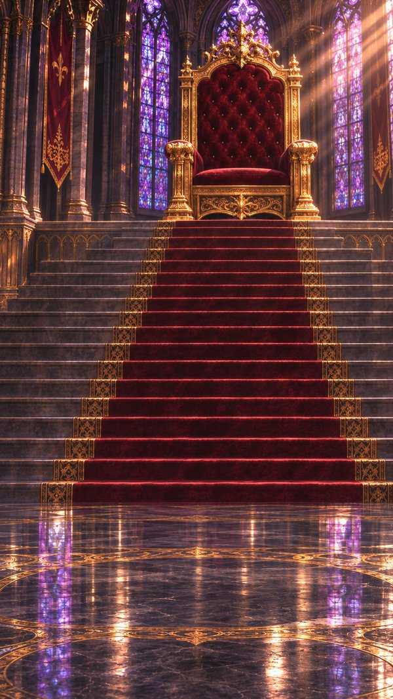

# Sala do trono — candidata da Bíblia Visual

- [PNG original com SHA](../../../videos/mmorpg-conquiste-a-princesa-ep01/assets/geracoes/production-art-request/44002126578/biblia-sala-do-trono-vazio-v1.png)
- [Registro das gerações](../../REGISTRO-GERACOES.md)
- [Workflow #44002126578](https://github.com/HelioConde/VideoForge-IA/actions/runs/44002126578)
- **Status: gerado, não aprovado.** Conferir se realmente não aparecem Kael, Rei Aldric, guardas, sombras de personagens ou lanças. Preservar trono, degraus, vitrais, iluminação e câmera.
- A prévia JPG reduzida não altera o PNG original de 941×1672. Não promover automaticamente a cenário canônico nem liberar o EP01.
