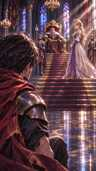

# Dorama — identidade visual oficial do canal Alchemy Lab

## Regra de qualidade sem limite editorial de imagens (15/11/2026)

**Sem número máximo predefinido de imagens.** Em trabalho autorizado, usar tantos planos-mãe, ângulos independentes, fundos, recortes RGBA e refinamentos quantos forem necessários para fazer o dorama **bonito, bem animado e extremamente detalhado**, sem alternar estilos/personagens. Evitar duplicações sem propósito; manter os controles de recursos, segurança e custo.

**Registro obrigatório de cada avanço:** arquivo principal [ESTADO-ATUAL.md](../videos/mmorpg-conquiste-a-princesa-ep01/ESTADO-ATUAL.md) (a fonte de retomada). A cada ação material, registrar evidência, arquivos/SHA, resultado, obstáculos e próximo passo; atualizar [histórico](../videos/mmorpg-conquiste-a-princesa-ep01/HISTORICO-DESENVOLVIMENTO.md) e [estado JSON](../videos/mmorpg-conquiste-a-princesa-ep01/estado-atual.json). Ler isso **antes** de gerar ou animar para não refazer o que existe.

**EP01:** `SEM-GERACAO-NOVAS-IMAGENS.lock` permanece ativo; eliminar a cota editorial não é liberar novas imagens.

> **Regra editorial específica da série de doramas.** Não se aplica automaticamente a `kids`, `otaku`, `gamer` ou outros canais. Instituída pelo responsável em 15/11/2026 com a imagem de referência fornecida nesta conversa.

## Estilo oficial e fonte de verdade

**Cinematic Semi-Realistic Fantasy Anime** — fantasia medieval semirrealista em estética de anime, ilustração digital altamente detalhada, luz cinematográfica, profundidade, composição emocional. **Quase toda cena deve ter dramaticidade e um ângulo de câmera diferente do plano anterior**, mantendo personagens, cenário e continuidade identificáveis. Exceções narrativas devem ser justificadas.

[**Bíblia visual + prompt completo + variação de enquadramentos**](../videos/mmorpg-conquiste-a-princesa-ep01/PROMPT-OFICIAL-ESTILO-DORAMA.md)

[**Manifesto JSON para agentes**](../videos/mmorpg-conquiste-a-princesa-ep01/estilo-visual-oficial-dorama.json)

[**Miniatura da amostra visual enviada pelo usuário (JPEG reduzido, não fonte de sprite)**](../videos/mmorpg-conquiste-a-princesa-ep01/REFERENCIA-VISUAL-DORAMA-PREVIEW-96.jpg)

**Amostra original:** 864×1536 px, JPEG/JFIF, SHA-256 `2bab99670444001fbccf8a6c861276e93dfb56f04a33ba5f542698ad3419b2e1`. O arquivo de imagem original em resolução plena foi apresentado na conversa, **mas não está versionado em resolução plena no repositório**; o repo contém uma miniatura autêntica de 96×171 px. Para obter detalhes de consistência pixel a pixel, usar as imagens-mãe já aprovadas, não essa miniatura.

## Ordem editorial para planos futuros

1. Ler a bíblia visual oficial e o roteiro do plano; identificar evento, emoção, personagens e geografia.
2. Aplicar prompt base constante; adaptar a ação, a luz e os objetos ao cenário específico (não inventar trono/vitrais onde não existem).
3. Variar **posição e altura de câmera, tamanho de plano e foco emocional** em relação ao plano anterior, com eixo narrativo consistente.
4. Verificar rostos, roupas, armas, anatomia, máscaras, silhuetas e continuidade de iluminação antes de aprovar.
5. Se o plano for animado, respeitar o [manual de rig/mesh](../../../docs/MANUAL-PRINCIPAL-ANIMACAO-2D.md); **não substituir ossos por movimento do PNG inteiro**.

**Restrição vigente:** o episódio [`mmorpg-conquiste-a-princesa-ep01`](../videos/mmorpg-conquiste-a-princesa-ep01/ESTADO-ATUAL.md) tem [bloqueio ativo de novas imagens](../videos/mmorpg-conquiste-a-princesa-ep01/SEM-GERACAO-NOVAS-IMAGENS.lock). Registrar o estilo oficial **não autoriza** gerar/editar imagens por IA para este episódio; só muda a especificação editorial para uso quando explicitamente permitido. A C01-P03 V5 permanece a versão técnica atual aguardando aprovação visual. Não publicar no YouTube sem autorização.
