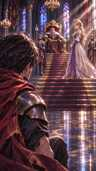

# Bíblia visual e prompt oficial — Dorama MMORPG: Conquiste a Princesa

> **ATUALIZAÇÃO 15/11 — REMAKE V2:** nova geração editorialmente autorizada para refazer o episódio, sem limite arbitrário de imagens. Ler [plano oficial](REMAKE-EP01-PLANO-OFICIAL.md) e [estado mestre](ESTADO-ATUAL.md). Menções ao bloqueio de imagens em trechos históricos abaixo referem-se ao período anterior ao remake. Ainda não há imagens ou vídeo novo aprovado, nem autorização automática de despesas/publicação.

**Registro editorial:** 15/11/2026. **Canal/escopo:** `canal/alchemy-lab/videos/mmorpg-conquiste-a-princesa-ep01`, com possibilidade de reutilizar como guia em futuros episódios da **série dorama** após aprovação. **Não é uma regra para todos os canais do VideoForge-IA.** Fonte: imagem apresentada pelo usuário e instrução explícita: *“quase toda cena tem que ser dramática de um ângulo diferente; essa imagem é uma boa amostra de como devem ser as imagens só do projeto dorama”*.

> **ESTILO VISUAL OFICIAL: CINEMATIC SEMI-REALISTIC FANTASY ANIME**  
> Uma ilustração digital de anime semirrealista, fantasia medieval, narrativa emocional, iluminação cinematográfica e enquadramentos variados. **Não confundir estética da arte com técnica de animação**: o rig articulado/mesh usa Three.js + Remotion e permanece regido pelo [manual principal](../../../../docs/MANUAL-PRINCIPAL-ANIMACAO-2D.md).

## Princípio novo — qualidade sem teto artificial de imagens

A série não tem máximo numérico editorial de imagens. **Quando autorizado**, produzir quantos planos com perspectiva verdadeira, imagens-mãe, camadas detalhadas e revisões forem necessários para consistência visual e rig 2D convincente. A qualidade define a necessidade de material; não inflar quantidade por si só. Isso não remove limites efetivos do serviço ou controles de orçamento e **não cancela o bloqueio de geração atual do EP01**.

Antes de cada ação, ler [ESTADO-ATUAL.md](ESTADO-ATUAL.md). Depois de todo avanço material, registrar ali **o que foi feito, quais arquivos/SHA, testes, falhas e próximo passo**, atualizar [histórico](HISTORICO-DESENVOLVIMENTO.md) e [estado JSON](estado-atual.json). Proibido reiniciar por falta de contexto.

## 1. Amostra visual indicada pelo responsável

- Arquivo **original fornecido nesta conversa**: `1000402660.png` (apesar da extensão, os bytes são **JPEG/JFIF**, **864 × 1536 px**, RGB, retrato). SHA-256 exato dos bytes apresentados: `2bab99670444001fbccf8a6c861276e93dfb56f04a33ba5f542698ad3419b2e1`.


**Amostra realmente arquivada neste GitHub:** [miniatura JPEG 96 × 171 px](REFERENCIA-VISUAL-DORAMA-PREVIEW-96.jpg), derivada por redução técnica sem IA a partir do arquivo que o usuário enviou. SHA-256 da miniatura: `58f22420d123561623944e369c08c7d6a1808df29dc2e3f5d795129c5d2192b4`. **A imagem original de 864 × 1536 px NÃO foi copiada integralmente** para o GitHub nesta atualização; seu SHA-256 original está registrado acima. **Não confundir thumbnail com referência em resolução plena** para desenho de sprites ou máscaras.

- **O que define a referência:** Kael ajoelhado em primeiro plano lateral/traseiro (armadura gasta, capa vermelha); princesa loira em vestido branco-lilás com bordados dourados no alto da escadaria; rei coroado ao fundo em trono ornamentado; guardas com lanças; catedral/salão gótico, vitrais coloridos, candelabros, degraus vermelhos, mármore reflexivo; raios volumétricos diagonais, contraluz dourada, atmosfera dramática e profundidade de cena.
- **Linguagem de composição a preservar:** primeiro plano com escala maior para gerar imersão, plano médio expressivo, fundo narrativo legível, linhas de fuga das escadas e dos vitrais, foco emocional entre dois personagens, riqueza de detalhes sem perder hierarquia visual.
- A imagem serve de **referência de qualidade, acabamento, paleta, profundidade, emoção e consistência de personagens**, não de obrigação de copiar o trono, o palácio ou exatamente esse enquadramento em todos os planos.
- A miniatura derivada da referência (caso arquivada) é somente índice visual; o SHA acima identifica o **arquivo original**. Não confundir thumbnail reduzida com imagem-mãe de animação, não utilizar thumbnail como fonte de sprites.
  
## 2. Regras editoriais obrigatórias

1. **Quase toda cena deve contar uma emoção com enquadramento dramático**: tensão, poder, reverência, ameaça, conflito, mistério, destino, sacrifício ou romance, escolhidos pelo momento do roteiro. Uma cena de descanso pode ser propositalmente mais calma para dar contraste; não dramatizar artificialmente cada quadro.
2. **Mudar o ângulo de maneira narrativa entre planos consecutivos**; não repetir sistematicamente a mesma câmera frontal e central, nem usar apenas zoom/crop da mesma imagem. Alterar posição espacial verdadeira de observação, altura, distância, profundidade e posição dos personagens. Uma repetição pode ocorrer intencionalmente como *match cut* ou reação, mas deve ser justificada.
3. **Personagens consistentes em todas as perspectivas.** Preservar rosto, idade aparente, cor e desenho do cabelo, figurino, símbolos, ferimentos, armadura, acessórios e escala relativa de Kael, princesa, rei e guardas. Manter fichas de personagem e imagens-mãe SHA-verificadas como referências de identidade, sem reinvenção de design entre cortes.
4. **Cenários consistentes na geografia e no tempo.** Se a ação permanece no mesmo salão, janelas, trono, degraus e direção da luz devem ser reconhecíveis, mesmo de outro ângulo; não teletransportar personagens ou trocar o lado de objetos entre tomadas.
5. **Acabamento da referência:** traços faciais de anime semirrealista, anatomia e materiais convincentes, tecidos luxuosos/rasgados conforme o personagem, metais com desgaste, bordados finos, reflexos contidos, tons vinho/dourado/roxo/azul e fachos de luz atmosféricos. Evitar alternar para foto realista, 3D plástico, chibi, cartoon plano ou estilos de anime incompatíveis.
6. **Composição vertical 9:16 como padrão de Shorts** quando o roteiro do canal exigir; manter rostos, mãos e silhuetas íntegros, espaço seguro para legendas e movimentação por malha. Não cortar coroa/cabelo, bota ou lanças.
7. **Dramaticidade não significa movimento excessivo**: no plano C01-P03 V5 o rei e as lanças ficam imóveis e Kael respira sutilmente; a força narrativa vem de posição, iluminação, contexto e pequena atuação.
8. **Sem duplicações:** 1 personagem por identidade no plano, sem braços extras, lanças duplicadas, coroas flutuantes ou personagens repetidos no fundo. Verificar o espaço de profundidade e os limites das máscaras.
9. **Coerência entre tomadas:** antes de aprovar, comparar a arte nova com o plano anterior e com a amostra de estilo, não somente com a descrição textual.
10. **Autorização atual do remake (15/11/2026):** o pedido posterior de refazer o EP01 com as novas regras substituiu o lock de 14/11 apenas para novas imagens do remake. O lock foi arquivado e retirado do caminho ativo. Imagens só são consideradas produzidas quando os bytes e SHA estiverem persistidos; **nenhum serviço externo pago ou publicação está autorizado automaticamente**.

## 3. Prompt mestre — estilo constante (inglês)

Usar o bloco abaixo em pedidos de imagens futuras **quando autorizados**. Substituir os campos entre colchetes por conteúdos reais do plano, sem repetir a mesma composição em todos os prompts.

```text
CINEMATIC SEMI-REALISTIC FANTASY ANIME, premium hand-painted fantasy anime key visual, cohesive character design and recognizable face across every shot, painterly yet anatomically believable proportions, delicate expressive anime eyes, sophisticated detailed digital painting, elegant medieval high-fantasy art direction, rich embroidered fabrics and worn metallic armor, intricate believable architecture and props, volumetric sunlight and atmospheric perspective, sophisticated color grading, luminous stained-glass accents when appropriate to the location, controlled depth of field, cinematic contrast with warm highlights and cool shadow tones, intricate textures, natural hair strands, atmospheric storytelling, grounded physical scale, emotionally charged composition, strong silhouettes, foreground / midground / background separation, professional anime film still quality.

SCENE: [exact event from the approved screenplay, what changed since the previous shot]
SETTING: [confirmed location and its continuity landmarks]
CHARACTERS: [fixed identity sheets and approved designs, costumes, injuries and accessories]
ACTION AND EMOTION: [one clear dramatic action and the character's inner conflict]
CAMERA: [new dramatic angle, actual spatial vantage point, shot size, focal emphasis]
COMPOSITION: [foreground anchor, leading lines, midground reaction, background geography]
LIGHT AND PALETTE: [lighting direction consistent with the sequence, volumetric effects only if motivated]
CONTINUITY: [unchanged character IDs and recognizable architecture from adjacent shots]
OUTPUT: [portrait 9:16 if intended for Shorts; do not crop faces, crowns, hands, shoes or weapons], coherent visual identity, clear emotional focal point, refined illustrative detail.

Reference aesthetic: a battered red-caped kneeling warrior seen over the shoulder in an immense gothic royal hall; delicate lavender-and-gold dressed princess ahead; crowned king seated far beyond on a gilded throne; guards and stained-glass shafts of warm light. This is a quality and mood reference, not a request to repeat those objects in every setting.
```

**Essencial:** na geração de uma cena **fora** do salão, trocar setting, luz, personagens visíveis e adereços para o lugar correto. A estética deve continuar reconhecível; **não adicionar trono, princesa ou vitrais ao acaso**.

## 4. Seleção dramática de câmera

Escolher um novo ângulo que tenha *motivo narrativo* e registrar no JSON de direção; não escolher só para “variar”:

| Enquadramento | Efeito | Exemplo de uso (não repetir seguidamente) |
|---|---|---|
| Over-the-shoulder / por trás do ombro | Identificação com o protagonista e distância dramática | Kael observa a princesa e o rei |
| Low-angle / contraplongée | Poder, opressão, majestade | Rei dominando o trono |
| High-angle / plongée | Vulnerabilidade, isolamento | Kael ajoelhado diante de guardas |
| Close-up 3/4 | Emoção íntima e tensão no olhar | Princesa hesita em responder |
| Profile two-shot | Choque de decisões, contraste de poder | Reação entre dois personagens |
| Wide establishing shot | Escala arquitetônica e geografia | Salão inteiro antes de conflito |
| Foreground occlusion / através de objeto | Suspense, segredo e profundidade | Acompanhamento através de uma lança ou coluna |
| Rear silhouette / contraluz | Destino, perda e isolamento | Figura diante de luz do vitral |
| Dutch angle suave | Instabilidade psicológica pontual | Reviravolta/ameaça, não uso frequente |
| Detail insert / plano-detalhe | Informação de enredo | Espada desembainhada, joia, mão tensa |

**Controle de repetição:** cada par de planos adjacentes deve variar pelo menos **dois** entre posição lateral da câmera, altura, tamanho de plano, direção do olhar e predominância de primeiro plano. Se repetir, registrar a justificativa na direção. Não quebre o eixo de 180° sem motivação/intenção explícita.

## 5. Negative prompt / QA de defeitos

```text
photorealistic live-action, plastic 3D render, cheap game CGI, chibi, flat western cartoon, generic stock fantasy, inconsistent faces, redesigned hair or clothing, inconsistent ages, random modern elements, mismatched time of day, low detail, flat lighting, sterile empty set, random perspective change, bent architecture, duplicated characters, extra limbs or fingers, fused hands, floating objects, doubled spears, cut-off crowns, cropped heads, broken armor joints, warped feet, inconsistent prop direction, misplaced shadows, excessive bloom, overexposed highlights, muddy shadows, oversaturation, low contrast readability, unreadable silhouettes, unwanted text, watermark, logo, unintentional lens distortion
```

**Contrato configurável para agentes:** [`estilo-visual-oficial-dorama.json`](estilo-visual-oficial-dorama.json). Este JSON registra o estilo, a alternância de câmeras, a consistência visual e o bloqueio de geração atual. Não substitui o parser de direção nem passa a ser usado pelo renderer automaticamente.

## 6. Contrato de direção por plano

O agente de roteiro define o **evento e emoção**; o agente de arte prepara o prompt mestre + personagens/figurinos + ângulo; o verificador de continuidade rejeita cortes repetitivos, mudança de rosto, troca de estilo, coroa, braços/pés e geografia; o agente de rig deve respeitar o manual de malhas. Para cada futuro plano autorizado, registrar no JSON:

```json
{
  "visual_style": "cinematic-semi-realistic-fantasy-anime/v1",
  "scene_id": "Cxx",
  "shot_id": "Cxx-Pyy",
  "dramatic_intention": "emotion + story beat",
  "angle": "over-shoulder / low / high / profile / 3-4 / wide / insert",
  "shot_size": "wide / medium / close-up / detail",
  "foreground": "one grounded visual element",
  "midground": "primary action and clear silhouette",
  "background": "spatially continuous landmarks",
  "light_direction": "consistent with neighboring shots",
  "characters": ["approved character identity IDs"],
  "preceding_shot_angle": "previous plan's angle",
  "angle_change_justification": "at least two changes in composition or narrative exception",
  "reference_match_reviewed": false,
  "identity_continuity_reviewed": false,
  "image_generation_authorized_for_this_episode": false
}
```

Esse contrato **não substitui** o esquema de direção existente e não autoriza chamadas a IA. Os campos podem ser integrados ao schema do roteirista apenas após revisar o parser correspondente.

## 7. Checklist de aprovação editorial

- [ ] O acabamento parece com a **amostra apresentada pelo usuário**, não com arte genérica?
- [ ] O propósito dramático é evidente sem depender de texto narrado?
- [ ] A câmera realmente muda de lugar/altura/distância de um plano para o seguinte, de modo coerente com a história?
- [ ] Os rostos, figurinos, acessórios e proporções dos personagens são consistentes?
- [ ] O espaço arquitetônico, a direção da iluminação e o eixo narrativo se mantêm?
- [ ] Não há membros extras, lanças duplicadas, cabeças/coroas cortadas ou áreas deformadas?
- [ ] O plano 9:16 protege silhuetas, cabelo e espaço de legenda?
- [ ] A arte aprovada pode ser isolada em camadas e deformada sem inventar o que fica oculto?
- [ ] Se o plano pertence ao **EP01 bloqueado**, **nenhuma nova imagem foi gerada ou editada por IA**?
- [ ] A aprovação artística foi concedida por humano antes de marcar `publishable=true`?

**Fonte de verdade de continuidade:** [estado atual](ESTADO-ATUAL.md), [histórico](HISTORICO-DESENVOLVIMENTO.md), [AGENTS.md](../../../../AGENTS.md), [bloqueio de novas imagens EP01](SEM-GERACAO-NOVAS-IMAGENS.lock). A V5 da cena C01 permanece o MP4 técnico atual; este arquivo não a substitui ou re-renderiza.
