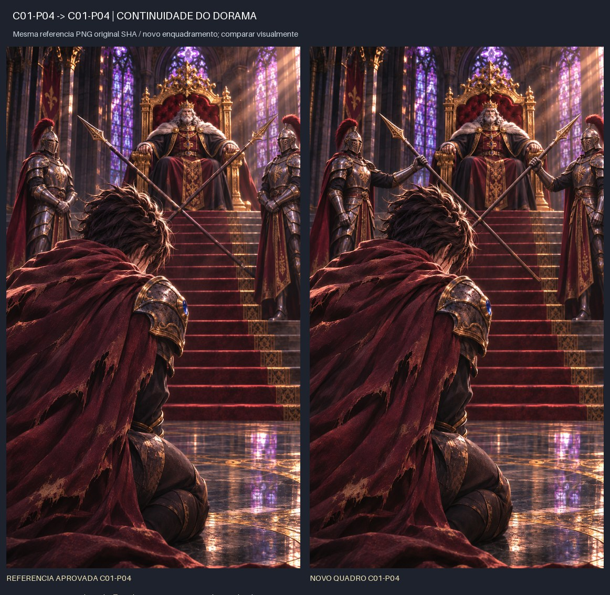

# EP01 — C01-P04 V4: guardas seguram as lanças

**Origem do problema:** erro apontado pelo responsável em 16/11/2026. Na V3, ambos os guardas tinham mãos juntas sem contato com lanças; as armas apareciam flutuando.

[Comparação lado a lado](QA-C01-P04-V3-VS-V4-LANCAS.jpg) · [PNG V4 original](assets/geracoes/production-art-request/43990928355/c01-p04-pegada-lancas-v4.png) · [PNG V3 original](assets/geracoes/production-art-request/43965460068/c01-p04-imagem-inicial-v3.png) · [Execução do GitHub #43990928355](https://github.com/HelioConde/VideoForge-IA/actions/runs/43990928355)

## Resultado da primeira inspeção visual

- **Na V4**, guarda esquerdo alcança e envolve com uma mão enluvada sua haste; guarda direito faz o mesmo com a própria haste. As duas mãos estão visivelmente posicionadas na arma, não mais unidas em descanso enquanto as lanças flutuam.
- As duas lanças ainda formam X. Kael ajoelhado, Rei Aldric, armaduras, trono, vitrais, paleta e iluminação mantêm coerência com a V3.
- A geração V4 é uma **nova imagem-mãe candidata**, não uma promoção automática para animar ou publicar. O responsável deve confirmar que está satisfeito com anatomia, posição das hastes e direção dramática.
- Arquivo gerado pelo programa **no GitHub** via `/v1/images/edits`, com V3 original anexada por SHA `605ccd361ad9a867eb8b92948010fdbb7d87a031d8b3601c663d815917b1b6cc`. V4 SHA `0bb72ea525d81b6e935af49eb873d308a88ce8230a4a2b7d89c62d5d0e88a8dc`, **941×1672 pixels**, sem reamostragem de fonte. A diferença para 1024×1536 solicitados continua anotada.
- [Workflow de comparação #43991247393](https://github.com/HelioConde/VideoForge-IA/actions/runs/43991247393) **SUCCESS**: relatório SHA e PNGs comparados. Testes não podem provar anatomia; a análise acima é uma inspeção humana/visual assistida.

**Status:** `candidate_generated_and_visual_grip_observed_owner_review_pending`. Manter o lote de 37 imagens congelado para não propagar a pose antiga, até aprovar explicitamente a V4 ou solicitar ajuste. Após aprovação, alterar o registro de âncora para o SHA da V4 e retomar a esteira de imagens do EP01, sem reproduzir os três PNGs arquivados.
