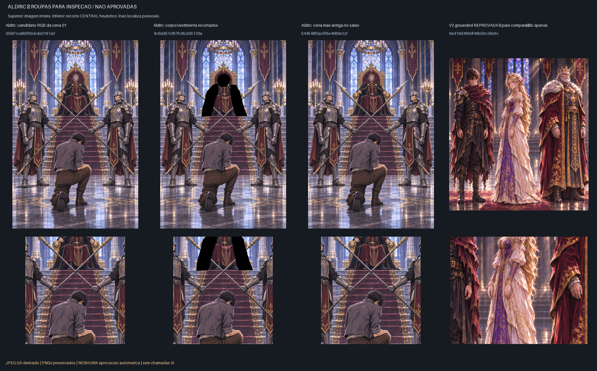
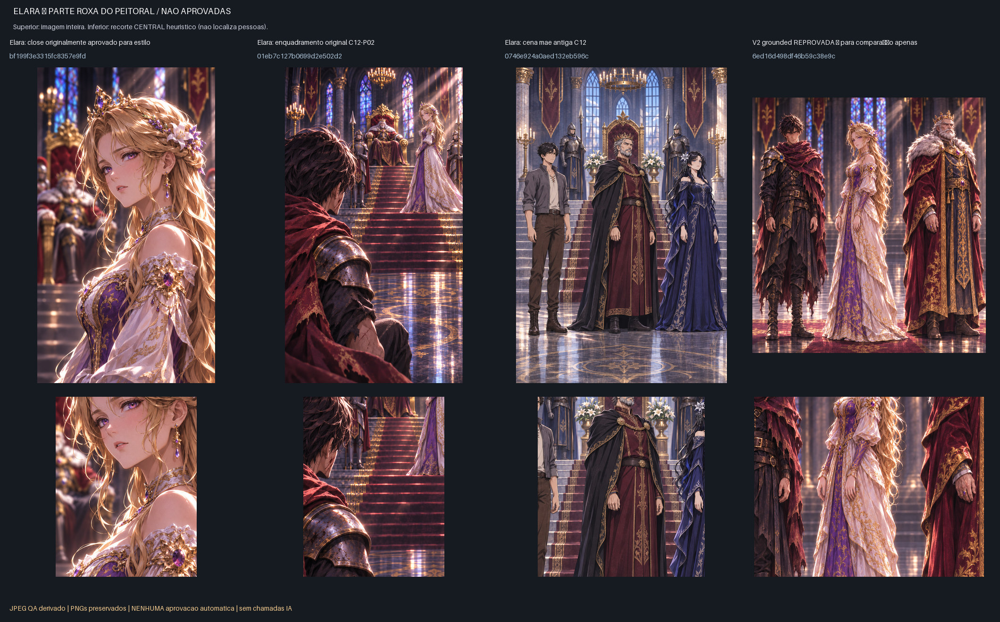

# EP01 V2 — revisar detalhes dos figurinos

**Não aprovar a candidata grounded anterior.** Sua roupa foi reprovada por divergência em Aldric e no painel roxo de Elara.

As duas folhas abaixo usam **somente imagens arquivadas**. A faixa superior mostra cada imagem original completa; a inferior amplia um retângulo central.
**O zoom não detecta automaticamente o torso**: se a pessoa estiver deslocada, o recorte pode não mostrar a roupa relevante. A imagem completa está logo acima.

## Aldric — comparação de traje real

Conferir gola clara, túnica vinho/bordô, bordados dourados, manto, coroa e posição dos ornamentos. Não usar recorte V1 como figurino canônico sem autorização.

## Elara — comparação do painel roxo

Conferir se a peça roxa fica no **mesmo local do peitoral/corpete palaciano** e se os bordados são conservados entre diferentes enquadramentos. Não comparar disfarce de rua com roupa real.

## Decisão de produção

- [ ] Elara — referência de roupa de corpo inteiro selecionada e aprovada explicitamente
- [ ] Aldric — referência de roupa de corpo inteiro selecionada e aprovada explicitamente
- [ ] Referências originais preservadas por SHA e não apenas parecidas
- [ ] A nova R2 só é solicitada depois dos dois figurinos fixados

**O preenchimento dos checkboxes não altera o estado do projeto.** A decisão precisa ser comunicada explicitamente e registrada no contrato.
