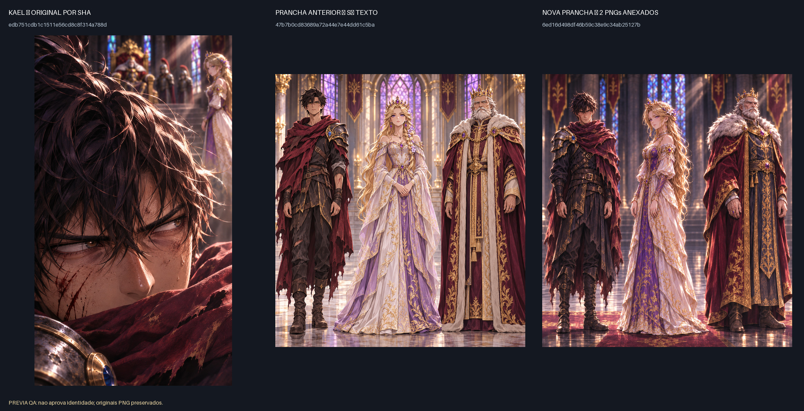

# EP01 V2 — PRANCHA REPROVADA por figurino

**Revisão do proprietário:** roupa do rei Aldric diferente entre as imagens e parte roxa da blusa/peitoral de Elara não preservada. Mesmo com SHA válido, a candidata NÃO pode ser utilizada como âncora. Veja [revisão oficial](REVISAO-FIGURINO-V2.json) e [contrato de figurinos](CONTRATO-FIGURINO-V2.json).

As duas fontes de Kael/Elara foram realmente anexadas à nova geração, por SHA.
A prova de anexos NÃO equivale à correspondência visual nem à aprovação.

## Kael

## Elara

## Critérios de revisão
- [ ] Kael mantém face, olhos âmbar, cabelo escuro e capa vinho
- [ ] Elara mantém face, olhos violeta, cabelo dourado e trajes
- [ ] Aldric: falta original individual aprovado
- [ ] Sem anatomia duplicada, personagens extras ou mudanças de estilo
- [ ] Sem cortar/deformar rostos para preencher formato diferente

**Não canonizar ou disparar tomadas com base apenas nestas prévias.**
Manter as duas pranchas arquivadas com SHA. Sem MP4 oficial/YouTube.
