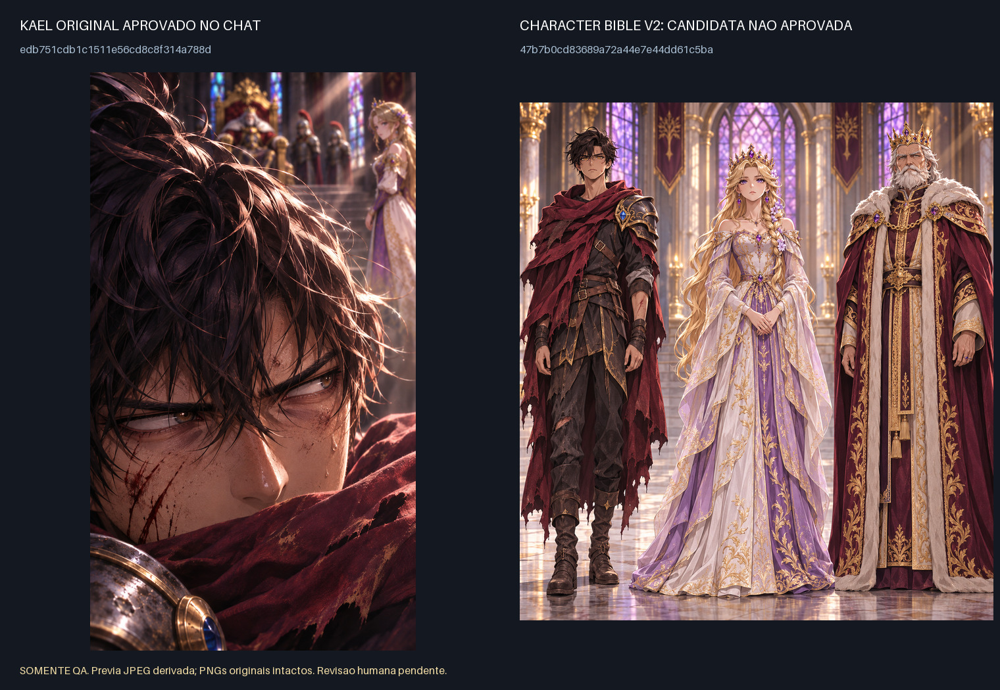
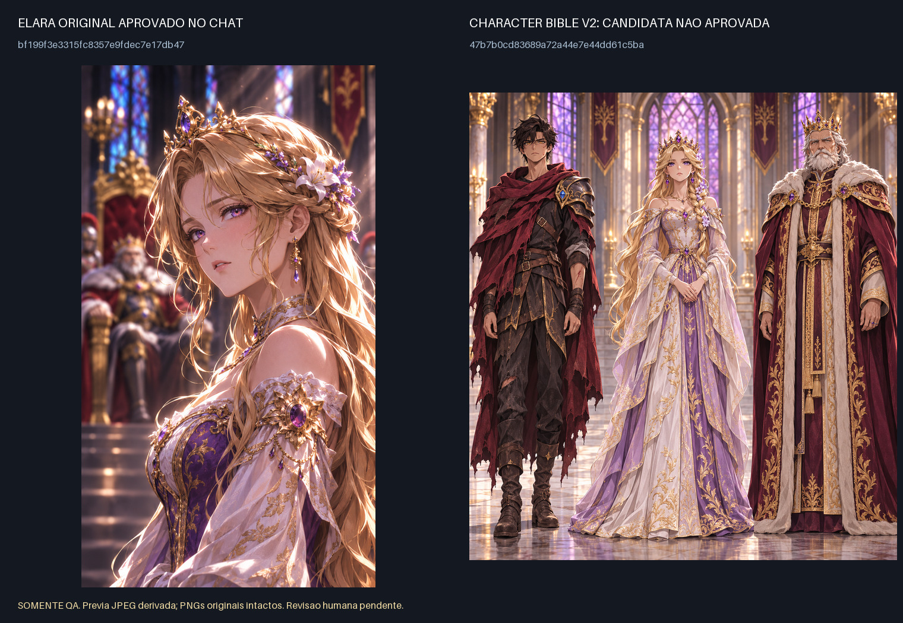

# EP01 V2 - comparacao visual de identidade

Fontes originais verificadas por SHA. O JPEG e apenas uma visualizacao.
A prancha V2 foi gerada por texto, sem as fontes antigas anexadas.
A integridade SHA nao comprova fidelidade do rosto, cabelo ou traje.

## Kael - original versus V2

## Elara - original versus V2

## Originais preservados

- [Kael original](assets/referencias/chat-aprovadas/kael-close-salao.png)
- [Elara original](assets/referencias/chat-aprovadas/elara-close-trono.png)
- [C12-P02 original](assets/referencias/chat-aprovadas/confronto-trono-c12-p02.png)
- [Character-bible V2 candidata](assets/geracoes/production-art-request/43784005362/character-bible.png)

## Verificacao que exige pessoa

- [ ] Identidade de Kael (olhos, rosto, cabelo, roupa, idade)
- [ ] Identidade de Elara (olhos violeta, cabelo dourado, coroa e vestido)
- [ ] Aldric (sem close individual aprovado por SHA)
- [ ] Anatomia e quantidade correta de personagens, sem membros extras
- [ ] Estilo 2D consistente com os originais e sem fotorrealismo
- [ ] Revelacao de Elara somente a partir de C12

Os checkboxes sao apenas instrucao. Nao alteram aprovacao no JSON.
Sem aprovar a identidade visual, nao liberar geracao de cenas ou upload.
