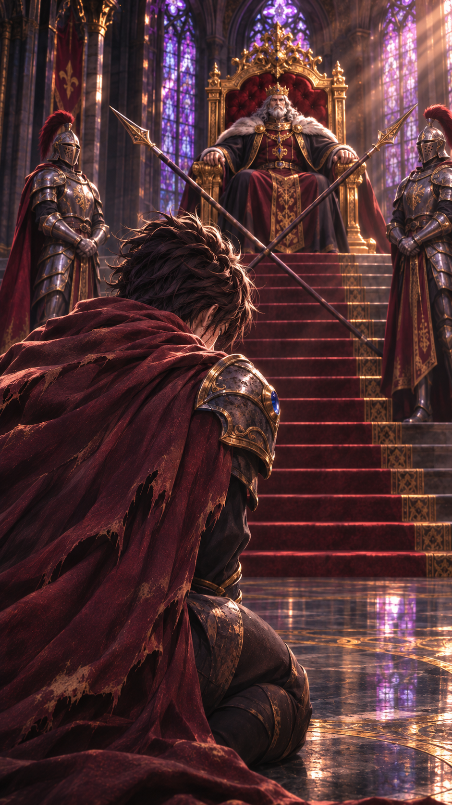

# Primeira imagem do julgamento — C01-P04 V3 (prévia de identidade)

**Status: gerada pelo programa no GitHub; candidata para revisão visual do responsável. NÃO aprovada automaticamente.**

- [Abrir PNG original](assets/geracoes/production-art-request/43965460068/c01-p04-imagem-inicial-v3.png)
- [Execução GitHub Actions #43965460068](https://github.com/HelioConde/VideoForge-IA/actions/runs/43965460068) — SUCCESS
- [Metadados e SHA da geração](assets/geracoes/production-art-request/43965460068/c01-p04-imagem-inicial-v3.production.json)
- [Manifesto arquivado com SHA](assets/geracoes/production-art-request/43965460068/manifesto-geracoes.json)

## Proveniência e requisitos

- Gerador: `videoforge.production_art` via Codex Proxy **no workflow do GitHub**, com `gpt-image-2` e edição com a imagem ORIGINAL de Kael anexada por bytes PNG e validada por SHA (`edb751cdb1c1511e56cd8c8f314a788d9adfb9d4338085cead281efa931ed65f`).
- PNG original arquivado: `assets/geracoes/production-art-request/43965460068/c01-p04-imagem-inicial-v3.png`. SHA-256 `605ccd361ad9a867eb8b92948010fdbb7d87a031d8b3601c663d815917b1b6cc` e 2.509.837 bytes. Resolução **941×1672**, enquanto o pedido era **1024×1536**. **Não esticar ou alterar os pixels**; programar contain/padding ou rig em dimensões reais após aprovação.
- O prompt usa a bíblia `PROMPT-OFICIAL-ESTILO-DORAMA.md`: ilustração anime de fantasia semirrealista cinematográfica (NÃO foto realista). Os personagens presentes são Kael, Aldric e dois guardas, **sem Elara**. O enquadramento é `C01-P04` (primeiro plano de conjunto do julgamento). No plano oficial `C01-P01` é preto com SFX, `C01-P02` é detalhe da espada e `C01-P03` é outro ângulo de Kael.
- O PNG gerado antes por outros meios **não foi enviado nem reutilizado como entrada**. Esta geração veio inteiramente do GitHub Actions; também não reutiliza automaticamente a candidata de figurino rejeitada de SHA `6ed16d49…`.

## Revisão visual requerida

1. **Kael:** rosto e cabelo da referência original, capa vinho rasgada, ombreira escura com ornamento dourado/pedra azul, anatomia, sem espada própria.
2. **Aldric:** barba grisalha-branca volumosa, túnica vinho no centro e tecido externo mais escuro, detalhes ouro e gola clara. **Não há imagem individual integral previamente aprovada dele anexada nesta geração**.
3. **Guardas e lanças:** exatamente dois guardas, armadura e elmos consistentes; lanças formam X **atrás** de Kael, sem atravessar mãos ou corpos.
4. **Estilo e ambiente:** sem fotorrealismo, manhwa plano, CGI plástico, fotomontagem ou cartaz; iluminação, vitrais e geometria consistentes, sem letras nem HUD.

**Após aprovação visual:** adaptar geometria SEM interpolação deformante, derivar background + personagens/objetos RGBA da própria imagem-mãe, reconstruir áreas ocultas, animar com rig Three.js/Remotion e renderizar quadro de teste. Não aprovar figurinos ou publicar YouTube por sucesso técnico de PNG.
