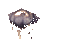
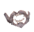
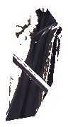
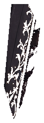
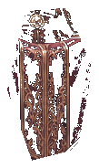
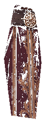
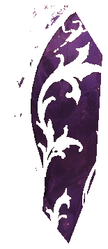
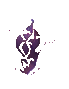

# EP01 V2 — conferência dos oito recortes filtrados

**Só para QA de imagens existentes.** Nenhum destes PNGs transparentes representa roupa canônica, rig animável ou aprovação semântica. O filtro HSV pode confundir objetos com tecido e descartar pixels verdadeiros. São pixels de fontes SHA-verificadas. A R2 permanece bloqueada.

[Prancha comparativa lado a lado](QA-ROI-MASCARAS-REFINADAS-V2.jpg) | [Manifesto com SHA, caixas e percentuais](QA-ROI-MASCARAS-REFINADAS-V2.json) | [Polígonos propostos](ROI-POLIGONOS-CANDIDATOS-V2.json)

## 1. Aldric — barba sentado x em pé

| C01 — sentado, candidata V1 | C02 — em pé, candidata V1 |
|---|---|
|  |  |

**Conferir:** branco/cinza dos fios, bigode, limites da mandíbula, lábios, pele, gola e reflexos; após a correção, a região B exclui testa/olhos, mas não é máscara de pelos perfeita. Pixels retidos no polígono: A 47,38%; B 49,24%.

## 2. Aldric — tecido externo sentado x em pé

| C01 — sentado | C02 — em pé |
|---|---|
|  |  |

**Conferir:** tecido escuro, detalhes dourados e possível lança atravessando C01. Pixels de arma não podem fazer parte da máscara da roupa. Retenção A 69,94%; B 67,44%.

## 3. Aldric — painel central sentado x em pé

| C01 — sentado | C02 — em pé |
|---|---|
|  |  |

**Conferir:** parte bordô/vermelha, brocados dourados, cinto e sombras. Não inferir continuidade de traje apenas destes segmentos V1. Retenção A 36,64%; B 27,74%.

## 4. Elara — corpete roxo em duas cenas palacianas

| Close original do chat | Enquadramento original C12-P02 |
|---|---|
|  |  |

**Conferir:** painel roxo, separação entre tecido, pele e joias. A segunda câmera tem escala menor e seleção parcial (A 54,27%; B 21,03%). Isso não prova que o painel desapareceu: é preciso confrontar os originais.

## Regras para avançar

1. Corrigir os contornos e excluir interferências a partir das fontes originais, nunca de prévias redimensionadas; recalcular os hashes dos derivados.
2. Exigir revisão de pose, personagem e mesma variante de roupa em ambos os lados antes de marcar máscaras como verificadas.
3. Só depois habilitar a comparação oficial por região. Divergências fortes podem REPROVAR; cores semelhantes NUNCA aprovam figurino/identidade completa.
4. Não promover a R2 antes de imagens de roupa completas aprovadas de Aldric e Elara.

**Estado factual em 16/11/2026:** 8 PNGs candidatos, 0/8 máscaras semanticamente verificadas, 0/4 pares habilitados para comparação oficial e 0/2 figurinos aprovados. Nenhuma imagem paga, MP4 oficial ou publicação YouTube foi produzida nesta etapa.

[Estado principal](ESTADO-ATUAL.md) | [Checkpoint estruturado](estado-atual.json) | [Regras dos agentes](../../../../AGENTS.md).
