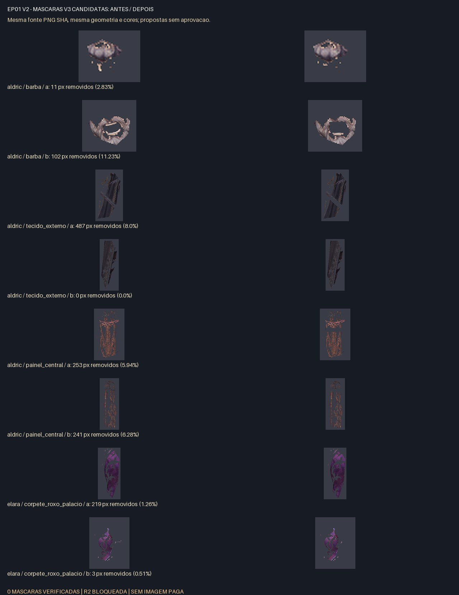

# EP01 — máscaras candidatas V3

## 16/11/2026 — Candidatas V3 e integridade de pixels (PR #63)

Corrigida a direção da exclusão no tecido externo de Aldric sentado, após inspeção do original: V2 atingia dobras acima da haste. V3 recupera 472 pixels e remove outros 258 em relação à V2; total excluído frente à máscara inicial: 487. Sete máscaras restantes idênticas por SHA. V2 e fontes originais preservadas. Não é aprovação semântica: EVIDENCIA_INSUFICIENTE nas oito regiões.

Programa valida RGB original, alfa somente subtrativo, recorte completo e contagem. Áreas protegidas bloqueiam exclusões sobre tecido anotado. 22 testes locais de ROI passaram; CI da branch será conferida antes do merge. Novo workflow qa-wardrobe-roi-pr.yml não gera imagens nem escreve no repositório. Produtor existente exporta V3 sem sobrescrever V2.

Arquivos: ROI-EXCLUSOES-CANDIDATAS-V3.json, QA-ROI-EXCLUSOES-V3.json, QA-ROI-EXCLUSOES-V3.jpg e assets/qa-roi-exclusions-v3/. Revisão: REVISAR-MASCARAS-FILTRADAS-V3.md. R2, MP4 e YouTube continuam bloqueados, zero chamadas pagas. Próximo passo: validar CI e integração; revisar barba/boca/gola, bordados e corpete pequeno contra as fontes completas antes de alterar contrato semântico.

[Versão anterior preservada](REVISAR-MASCARAS-FILTRADAS-V2.md) | [Relatório V3](QA-ROI-EXCLUSOES-V3.json)
