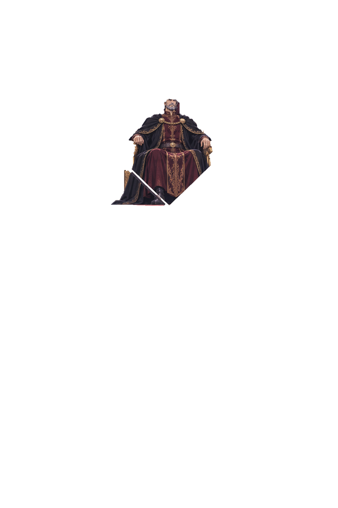
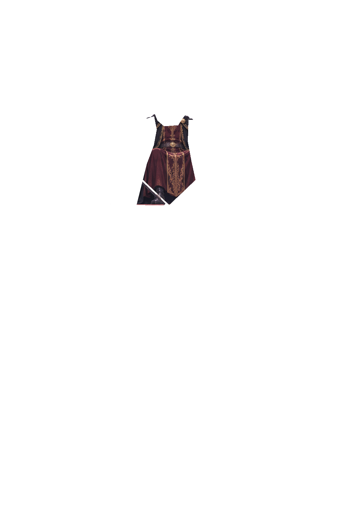
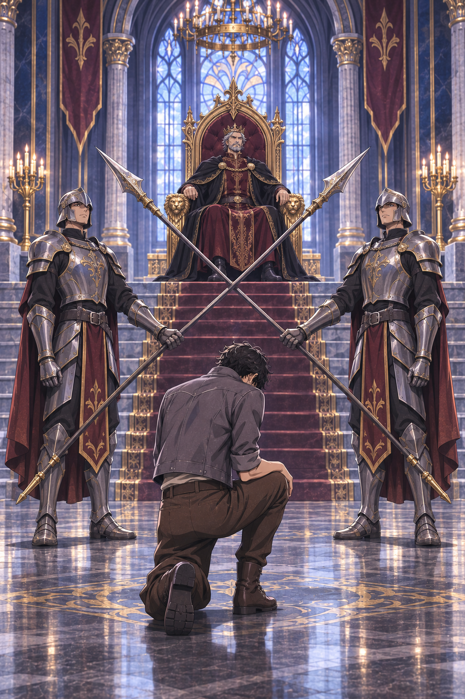
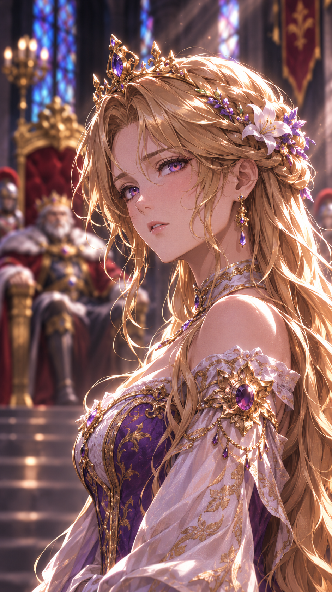
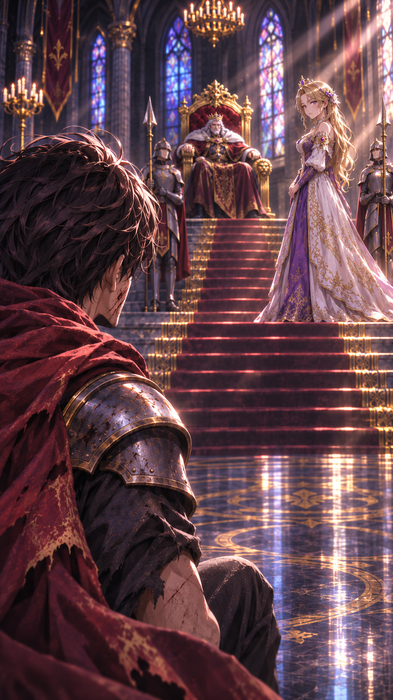
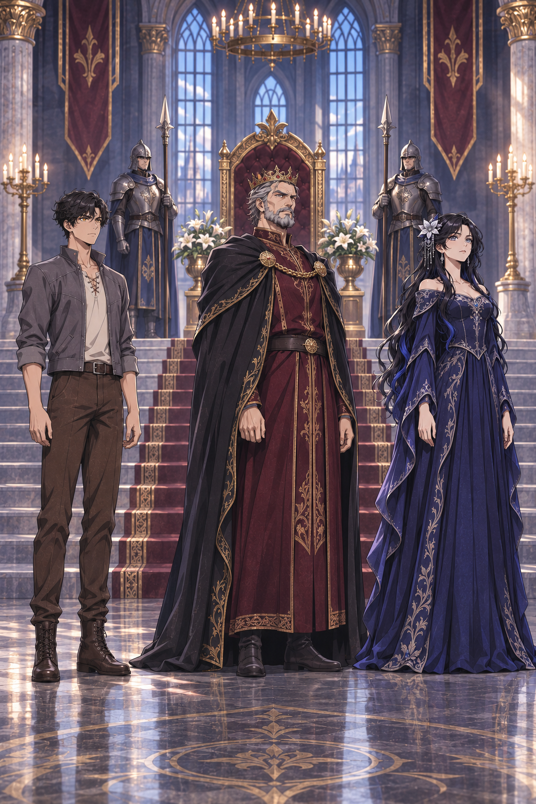

# Revisao de figurinos — fontes ja arquivadas (ainda NAO aprovadas)

O usuario reprovou a prancha grounded R1 por diferencas no traje do rei Aldric e no painel ROXO do peitoral da princesa Elara.
As artes abaixo sao somente opcoes de inspeção. Algumas sao recortes/cenas legadas V1. Nem SHA valido nem estilo previamente aprovado significam traje completo aprovado.

## Aldric: candidato RGB da cena 01

Origem: V1 candidate, not an owner-approved costume

SHA-256: 35691ca8bf90cbde0181a0d84835e146b0f7bc6507b51c60c35a6cf5b84cdf87

## Aldric: corpo/vestimenta recortados

Origem: V1 partial layer, not full-body canon

SHA-256: 4c6dd51cf87fc9bdd5126ae160474428f2bca9aaf801b051f8f2ad9694897833

## Aldric: cena mae antiga no salao

Origem: V1 scene context, non-canonical

SHA-256: 544548f0ac5f9e4686e2cf0d1477470f77e2fd7f15678d82799609b678fd6ebf

## Elara: close originalmente aprovado para estilo

Origem: Exact chat-original for visual style, NOT entire costume approval

SHA-256: bf199f3e3315fc8357e9fdec7e17db47f2a56c6fca6225b7f4983201fc2fcd6a

## Elara: enquadramento original C12-P02

Origem: Exact original camera framing, not wardrobe approval

SHA-256: 01eb7c127b0699d2e502d29dacec0bb39c0e1e23bf8205fdcf6fb70976e70535

## Elara: cena mae antiga C12

Origem: V1 scene context, non-canonical

SHA-256: 0746e924a0aed132eb596c5442265a38e65d43b4386c071ceedd466ad7e1499e

## Regras antes da proxima geracao

- Elara no palacio deve manter SEMPRE painel roxo na blusa/corpete e detalhes brancos, violetas e dourados; disfarce de rua e uma variante narrativa diferente.
- Aldric deve manter as mesmas vestes reais bordo/vinho e dourado, gola clara e coroa, sem redesign.
- As imagens legadas so podem ser usadas como referencias finais se forem inspecionadas e explicitamente aprovadas pelo usuario. Nunca promover candidatas automaticamente.
- Se nenhum modelo existente for fiel, obter/impor referencias individuais do traje completo de Elara e Aldric antes da R2.

Fontes completas aprovadas: 0/2.
Status R2: BLOQUEADA ate aprovacao visual e SHA das duas vestimentas.
Nenhuma imagem nova gerada ou publicada neste inventario.
