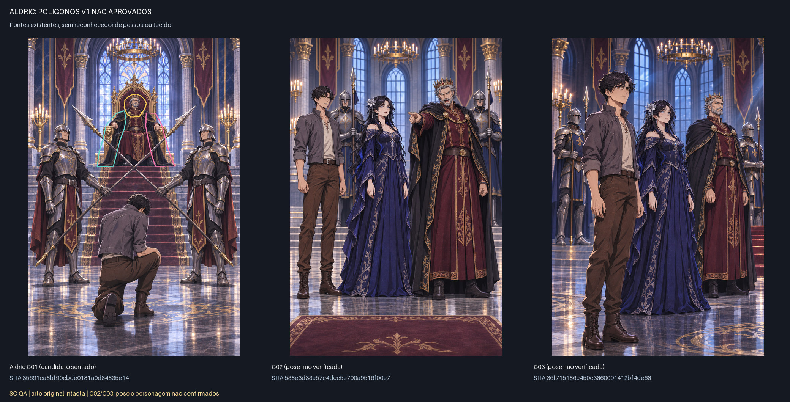
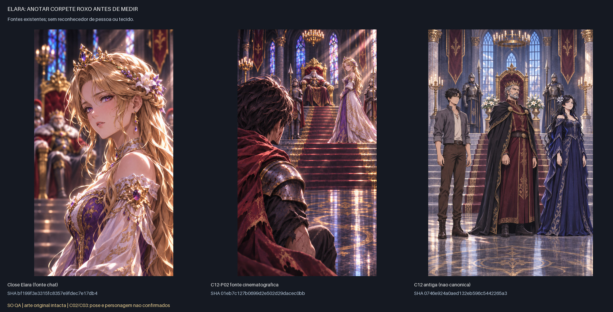

# EP01 V2 — revisão de regiões para filtro preciso de cor

As linhas desenhadas sobre Aldric são polígonos do rig V1 NÃO aprovados.
Eles incluem cabeça/coroa ou partes do manto, e NÃO isolam só barba ou centro da roupa.

## Aldric — C01, C02 e C03

C01 mostra os polígonos de cabeça/mantos V1. A identidade e pose em C02 e C03 não foram verificadas; precisam ser selecionadas antes de comparar sentado versus em pé.

## Elara — close, C12 e cena antiga

Nenhuma dessas fontes fornece automaticamente a máscara do peitoral roxo do vestido palaciano.

## Regiões que exigem identificação
- [ ] Barba de Aldric nas duas poses
- [ ] Tecido exterior de Aldric nas duas poses
- [ ] Tecido central de Aldric nas duas poses
- [ ] Corpete real de Elara nas duas imagens palacianas

Cada máscara precisa preservar o SHA da fonte e ser validada semanticamente antes da medição.
O sistema continua reprovando a referência antiga e não aprova a R2 sem fontes corretas.
